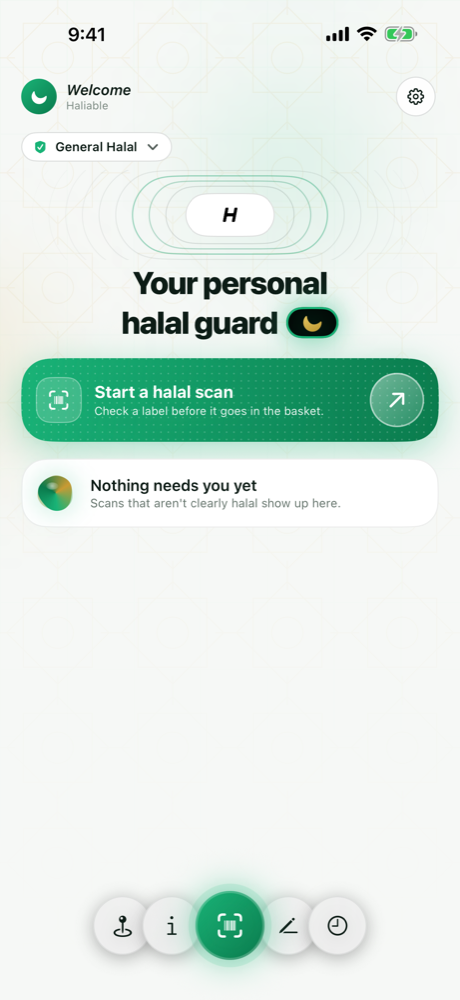
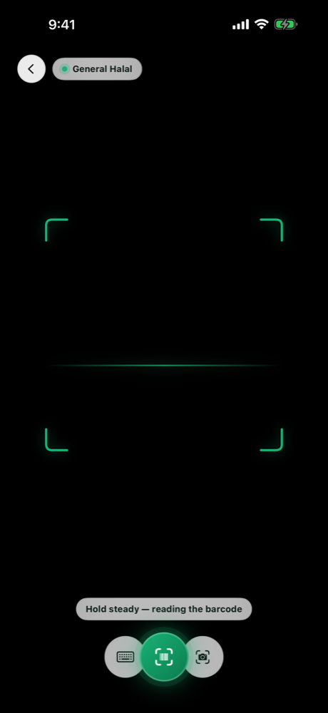
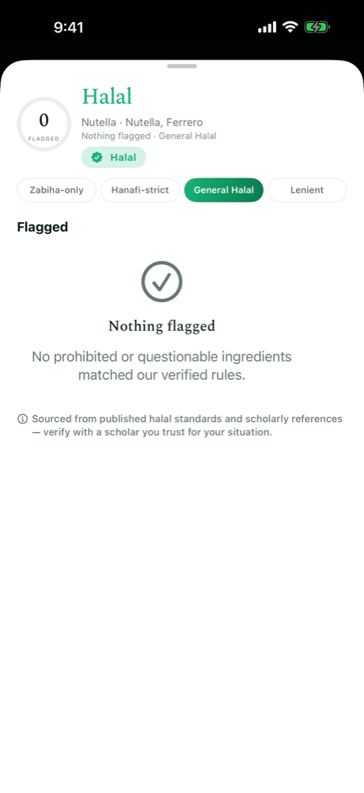
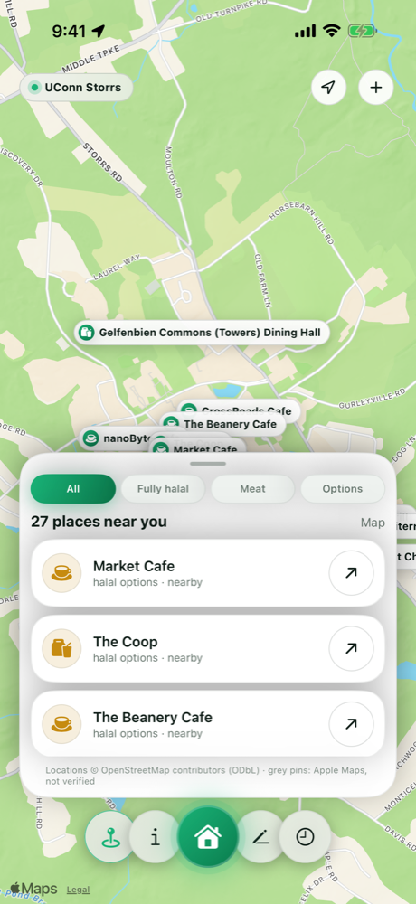
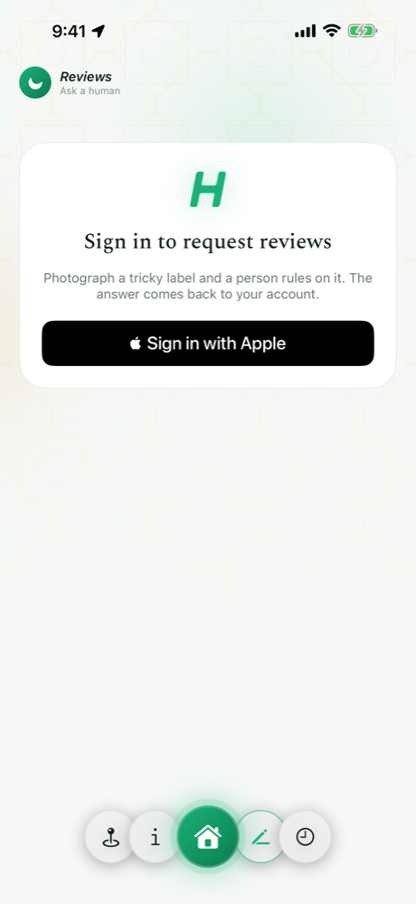
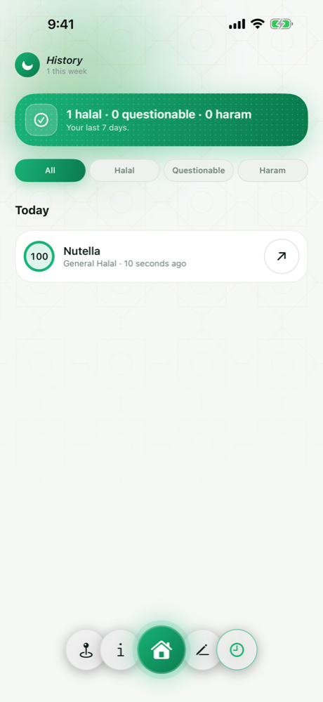
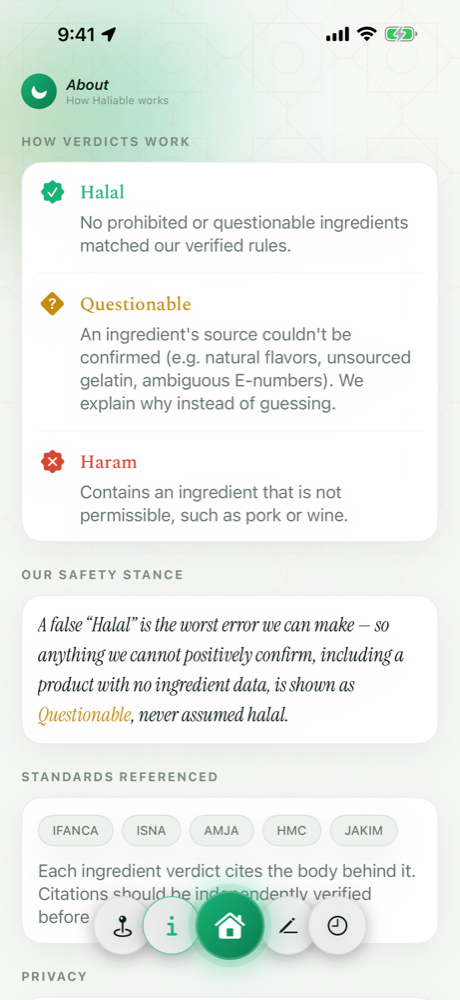
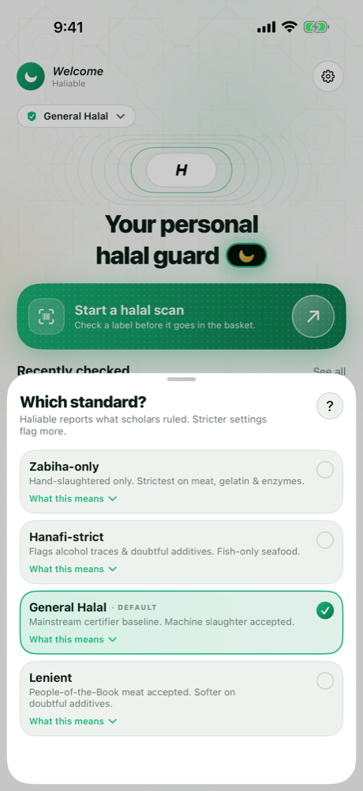

# Haliable

**The halal food scanner that shows its work.**

An iOS app that scans a product barcode, looks it up live against Open Food Facts and USDA FoodData Central, and reports a halal verdict — with the published scholarly sources behind every flagged ingredient shown right in the UI. No black-box rulings: every grade is backed by a citation the user can tap and read.

Built entirely in SwiftUI, with no UI packages: every animation is drawn natively. 143 Swift tests and 4 Deno tests. Live on TestFlight (build 14).

## Screenshots

| Home | Scanning | Verdict | Halal Atlas |
|:---:|:---:|:---:|:---:|
|  |  |  |  |

| Reviews | History | About | Your standard |
|:---:|:---:|:---:|:---:|
|  |  |  |  |

## What makes it different

Most halal-checker apps ship a static verdict database with no sources. Haliable takes the opposite approach:

- **Report, don't rule.** The app reports what published halal authorities say — it never issues its own religious ruling. When recognized bodies disagree, both positions are shown side by side instead of forcing a pick.
- **Worst-case-first safety stance.** An ingredient of unknown origin is graded at its most cautious plausible reading. A false "halal" is treated as the unforgivable error; a false "doubtful" is merely an inconvenience.
- **Citations as a hard gate.** An ingredient grade cannot leave "pending review" status until it carries at least one tier-1 or tier-2 citation (a standards body's own published document, or peer-reviewed work). High-traffic ingredients and lenient positions require two independent sources. The gate is enforced in code and covered by tests — 148 of 153 grade cells are cleared with 257 verified citations from bodies like JAKIM, MUI, MUIS, SANHA, SMIIT, and IFANCA.
- **Your standard, your verdict.** Users pick the standard they follow (general, Hanafi-strict, zabiha-only, lenient) and the same product re-grades live on screen.
- **Ingredient-level leverage.** Rules target ~130 ingredient/additive cells (E-numbers, gelatin, ethanol carriers, natural flavors…) rather than individual products — so the engine covers the millions of products in Open Food Facts and USDA without a bundled product database.

## Features

- **Barcode scanning** (AVFoundation) with a resilient lookup chain: USDA → Open Food Facts → local cache, with typed offline/rate-limited errors and centralized retry/backoff.
- **Five-level grading engine** (halal → widely accepted → doubtful/contested → avoid → haram) with per-standard grade matrices and a certified-brand layer that recognizes certifier marks (AHF, HFA, and others).
- **Store Atlas** — a community map of halal stores backed by Supabase/PostGIS: spatial nearby queries, validated submissions with server-side dedupe, and confirm/dispute voting, all through Postgres RPCs behind Row-Level Security.
- **Manual photo review** — when the verdict isn't a clean halal, users can submit product photos for human review.
- **Scan history** persisted locally with SwiftData. Rescanning a product replaces its old row. Each row shows an animated score ring, and any haram ingredient scores the product 0.
- **Cloud review agent.** A Supabase Edge Function reads the label photos and searches for a published halal-body passage, then checks by machine that the quote really appears on the page it cites. The verdict is the worst grade across all ingredients. Nothing reaches a user until the owner approves it, and unverified sources are never published.
- **Guard UI.** A custom design system with a floating dock, a dot-sphere scan orb, a liquid "thinking" orb for slow work, a sonar ring pulse and staggered screen reveals. All of it is drawn in SwiftUI `Canvas`/`TimelineView` and holds still under Reduce Motion.
- **Map beyond the Atlas.** Apple Maps places named "halal" or "zabiha" appear as grey "not verified" pins. Verified Atlas places reload as you pan.
- **Sign in with Apple** with full account lifecycle: server-side data export and one-tap account deletion (Postgres RPC wipes the user's rows, Netlify serverless functions revoke the Apple token per Apple TN3194).

## Architecture

```
SwiftUI app (iOS, iPhone)
├── RulesEngine + GradeMatrix     five-level grading, per-standard positions
├── CitationStore                 loads Citations.json; enforces the clearance gate
├── Lookup chain                  USDAFoodDataService → OpenFoodFactsService → ProductCache
│                                 (shared HTTPRetry: timeouts, 429/5xx backoff)
├── SwiftData                     scan history, local state
└── Supabase (PostGIS)            auth, review photos, Store Atlas RPCs, RLS throughout
    ├── Edge Functions            review-agent (Anthropic API + web search, quote-verified) · review-decide (owner approval) · delete-account
    └── Netlify functions         Sign in with Apple token store + revoke (ES256, no deps)
```

- **Secrets** live in a git-ignored `Secrets.xcconfig` (see `Haliable/Config/Secrets.example.xcconfig`); nothing sensitive is in source. The Supabase anon key is shippable by design — Row-Level Security protects the data.
- **Citation pipeline** (`docs/citations/`): candidate citations are researched, human-approved, then committed to `Citations.json` by an idempotent test-harness committer that validates structure, tiers, and source identity — the JSON is never hand-edited. An audit trail and progress ledger are regenerated on every run.
- **Database migrations** (`supabase/migrations/`) follow an up/down convention covering the stores table, spatial RPCs, vote RPCs, consolidated RLS policies, and the account-lifecycle RPC.

## Testing

143 Swift tests across the grading engine, citation gate, lookup resilience (offline, rate-limit, retry), store service, account deletion, and review flows — plus Deno tests for the review agent's verdict rules (quote verification, worst-case roll-up, SSRF guard), guard tests that fail the build on TODO markers, and screenshot UI tests that generate the App Store screenshots (1320×2868) automatically via `xcresulttool`.

```bash
xcodebuild test -scheme Haliable \
  -destination 'platform=iOS Simulator,name=iPhone 17 Pro' \
  CODE_SIGNING_ALLOWED=NO
```

## Getting started

1. Open `Haliable.xcodeproj` in Xcode 16+.
2. Copy `Haliable/Config/Secrets.example.xcconfig` → `Secrets.xcconfig` and fill in a free [USDA API key](https://fdc.nal.usda.gov/api-key-signup.html) and your Supabase project values (both optional — without them the app runs on Open Food Facts and local mock mode).
3. Build and run on an iPhone simulator or device.

## Data sources & attribution

- [Open Food Facts](https://world.openfoodfacts.org) — product data under the [Open Database License (ODbL)](https://opendatacommons.org/licenses/odbl/1-0/).
- [USDA FoodData Central](https://fdc.nal.usda.gov) — public domain (CC0).
- Halal positions are reported from the published documents of recognized certification and fatwa bodies; every citation in `Haliable/Resources/Citations.json` carries its source, tier, reference URL, and access date.

Haliable reports published positions for information only; it does not issue religious rulings. When in doubt, consult a scholar you trust.
